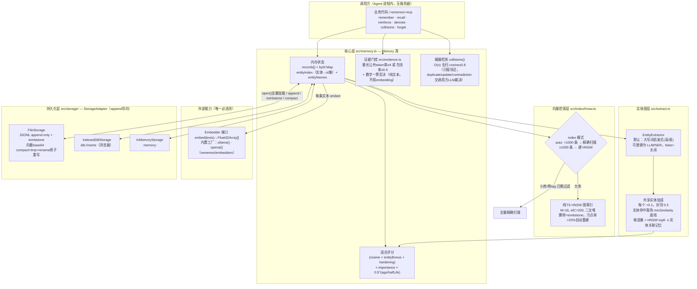
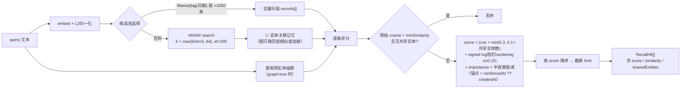
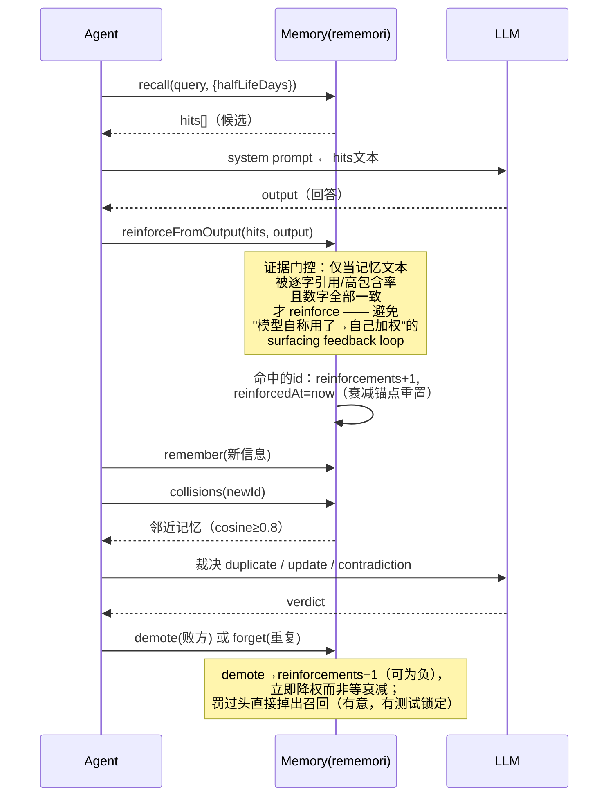

# rememori 原理架构图

> 依据 v0.7.0 源码（`src/`，约 1300 行）绘制。配套文档：[使用说明](./使用说明.md)。

## 1. 总体分层架构

## 2. recall() 查询流水线

## 3. 反馈闭环（防自强化设计）

## 4. 关键常量速查（src/memory.ts）

| 常量 | 值 | 含义 |
|---|---|---|
| `ENTITY_BONUS` / `CAP` | 0.1 / 0.3 | 每共享实体加成 / 封顶 |
| `HARDENING_STEP` / `CAP` | 0.05 / 0.15 | log2 阻尼反馈步长 / 封顶（正负对称） |
| `HNSW_AUTO_THRESHOLD` | 1000 | 超过则 auto 模式切 HNSW |
| `HNSW_REBUILD_RATIO` | 0.2 | tombstone 占比超过即重建索引 |
| `minRun` / `minContainment` | 4 / 0.6 | 证据门控阈值（evidence.ts，可调） |
| `collisions threshold` | 0.8 | 近邻判定 cosine 阈值 |

## 5. 设计上刻意"不做"的事

- **不做服务端/托管**：嵌入式原语，数据 = 单个本地 JSONL 文件
- **不在引擎内裁决矛盾**：embeddings 对矛盾句几乎同分，语义判断交上层 LLM
- **证据检测刻意不用 embedding**：防止反馈回路软性复活
- **recall 是纯读**：不自动强化——加权必须来自排序体系之外的显式信号
