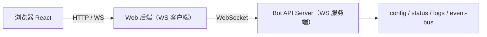
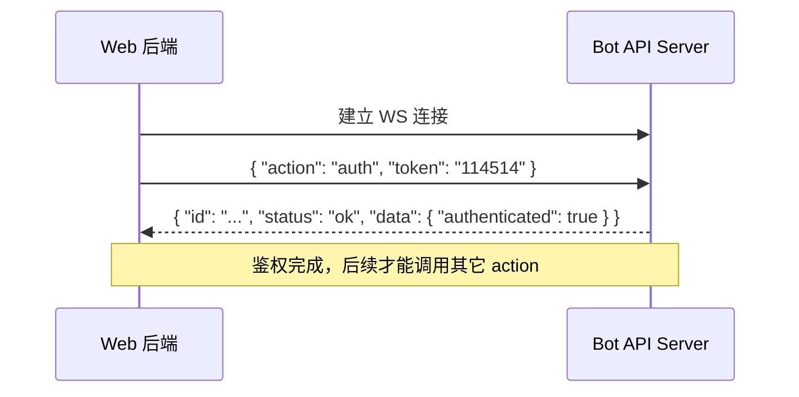

# SunbatwoBot Bot 端 API —— Web 后端对接开发文档

> 面向对象：Web 后端（Dashboard 服务端）开发者
> 通信方式：WebSocket（Web 后端为**客户端**，Bot 为**服务端**）
> 本文档依据 `core/api/` 现有实现编写，与代码保持一致。

---

## 1. 架构与连接方向

Bot 进程内嵌一个 API Server（`core/api/server.ts`），Web 后端作为 WS 客户端主动连接。



设计原则（对接前必读）：

- **两进程独立**：Web 后端重启不影响 Bot；断线重连逻辑只写在 Web 客户端一侧。
- **仅本机可达**：API Server 绑定 `127.0.0.1`，默认不对外网暴露。若 Web 后端与 Bot 不同机，需自行做反向代理/端口转发。
- **浏览器不直连 Bot**：鉴权 token 只保存在 Web 后端，前端页面通过 Web 后端间接取数。

---

## 2. 连接参数

连接地址来自 Bot 的 `config.web`（见 `core/config.js`）：

| 项 | 配置键 | 默认值 | 说明 |
|----|--------|--------|------|
| 主机 | —（固定） | `127.0.0.1` | 硬编码绑定本机 |
| 端口 | `web.port` | `2145` | 与 OneBot 的 `wsPort:8080` 分端口，互不影响 |
| 路径 | `web.path` | `/api/v1/ws` | WS 握手路径 |
| 鉴权 token | `web.token` | `114514` | **面板专用**，独立于 OneBot token |

完整连接 URL：

```
ws://127.0.0.1:2145/api/v1/ws
```

> ⚠️ 生产部署务必修改 `web.token` 默认值。

---

## 3. 消息协议

全部消息为 **UTF-8 JSON 文本帧**，共三类。类型定义见 `core/api/types.ts`。

### 3.1 请求帧（Web → Bot）

```jsonc
{
  "id": "c1a2b3",        // 客户端生成的唯一 ID，用于关联响应
  "action": "get_status",// 动作名，必须在白名单内
  "params": { },         // 动作参数（可选）
  "token": "***"         // 仅 action==="auth" 时携带
}
```

### 3.2 响应帧（Bot → Web，`id` 与请求关联）

```jsonc
// 成功
{ "id": "c1a2b3", "status": "ok", "data": { } }

// 失败
{ "id": "c1a2b3", "status": "error", "message": "unknown action: get_statuss" }
```

### 3.3 事件帧（Bot → Web，主动推送，无 `id`）

```jsonc
{
  "type": "event",       // 固定标识，用于区分响应帧与事件帧
  "event": "log",        // 事件名
  "ts": 1730000000000,   // 毫秒时间戳，供断线后按 since 补拉
  "data": { }
}
```

> **判别建议**：收到消息时先看 `type === "event"` → 事件；否则按 `id` 匹配挂起请求，看 `status` 判断成败。

---

## 4. 鉴权流程

连接建立后，**第一条消息必须是 auth 帧**，且在 **5 秒内**完成，否则被 Bot 强制断开。



- 鉴权成功响应：`{ id, status: "ok", data: { authenticated: true } }`
- token 不匹配或首帧非 `auth`：Bot 回 `error: unauthorized` 后关闭连接（**关闭码 4401**）
- 5 秒内未完成鉴权：Bot 直接关闭（**关闭码 4001**）
- 鉴权前调用其它 action：视为鉴权失败处理

### WebSocket 关闭码约定

| 码 | 含义 |
|----|------|
| `4001` | 鉴权超时（auth timeout） |
| `4401` | 未授权（unauthorized，token 错误 / 首帧非 auth） |

---

## 5. 保活（心跳）

Bot 每 **30 秒**对每个连接 `ws.ping()`，若上一周期无 `pong` 响应则判定半开并 `terminate()`。

- 使用 `ws` 库时，客户端会**自动回复 pong**，无需手动处理。
- 若 Web 端自行实现心跳，需保证对 ping 的 pong 响应，否则会被踢。

---

## 6. Action 能力清单（白名单）

以下为 Bot 端当前已注册的全部 action（`core/api/actions/`）。未知 action 一律返回 `error`，绝不透传执行。运行时可用 `list_actions` 动态获取。

### 6.1 `get_status` —— 运行状态快照

- 请求：`{ id, action: "get_status" }`（无参数）
- 成功 `data`：

```jsonc
{
  "uptimeMs": 3600000,       // 进程运行时长（毫秒）
  "onebotConnected": true,   // OneBot（NapCat）是否在线
  "mcpConnections": 2,       // 已连接的 MCP Server 数量
  "memoryMb": 128,           // 堆内存占用（MB）
  "nodeVersion": "v24.14.1"  // Node 版本
}
```

### 6.2 `get_config` —— 配置快照（脱敏）

- 请求：`{ id, action: "get_config" }`（无参数）
- 返回经过安全处理（见 `actions/config.ts`）的配置对象：
  - **敏感字段脱敏**：键名包含 `apikey / token / secret / password / key / pem` 的值，若已设置则替换为 `"***"`，未设置为 `null`。
  - **跳过字段**：`members`（Map）、`systemPrompt`（巨大文本）以及所有函数类型字段，不会出现在快照中。
  - 其余标量/数组字段原样返回。
- 成功 `data` 示例：

```jsonc
{
  "wsPort": 8080,
  "token": "***",           // 命中敏感规则被脱敏
  "web": { "port": 2145, "path": "/api/v1/ws", "token": "***", "logBufferSize": 1000 },
  "agentMode": "auto",
  "enableProactiveChat": true,
  "chatModel": "deepseek-v4.1-flash"
  // members / systemPrompt 已跳过
}
```

### 6.3 `set_config` —— 受控热改（白名单字段）

- 请求参数：`params: { key: string, value: any }`
- **仅允许修改白名单字段**（`WRITABLE_KEYS`）：
  - `agentMode`
  - `enableProactiveChat`
- 其它任何字段（尤其密钥类）：返回 `error: 该配置项不允许修改: xxx`
- 字段不存在：返回 `error: 配置项不存在`
- 成功 `data`：`{ "key": "agentMode", "value": "xxx" }`

> 白名单会随 Bot 端迭代调整，前端应容忍"不可改"错误并动态处理，勿硬编码可改字段。

### 6.4 `get_logs` —— 历史事件补拉（断线重放）

- 请求参数：

```jsonc
{
  "since": 1730000000000,  // 只返回 ts > since 的事件，默认 0
  "limit": 200             // 最多返回最近 N 条，默认 200
}
```

- 成功 `data`：`EventFrame[]`（结构同 3.3 事件帧，按时间升序，截取最近 `limit` 条）
- 用途：Web 后端重启/断线重连后，记录上次收到的最大 `ts`，用 `since` 拉取期间遗漏的事件。
- Bot 端为**固定容量环形缓冲**（默认 `web.logBufferSize: 1000`，超出覆盖最旧），因此 `since` 过早时最多只能取回缓冲内的最近 1000 条。

### 6.5 `list_actions` —— 能力清单

- 请求：`{ id, action: "list_actions" }`
- 成功 `data`：`{ "actions": ["get_status", "get_config", "set_config", "get_logs", "list_actions"] }`

---

## 7. 事件推送清单（Bot → Web）

事件通过内部事件总线（`core/api/event-bus.ts`）广播给**所有已鉴权**连接。事件命名约定为 `域.动作`。

| 事件名 | `data` 结构 | 触发源 | 状态 |
|--------|-------------|--------|------|
| `log` | `{ "level": "INFO"\|"WARN"\|"ERROR"\|"DEBUG", "ts": 1730000000000, "msg": "序列化后的日志文本" }` | `core/utils/logger.js` | **已实现** |

> 说明：`message.received`、`mcp.status` 等事件在设计文档中被规划，但当前 Bot 代码尚未接入。前端对接时应以 `list_actions` / 实际收到的 `event` 名为准，对未知事件名做兼容处理（忽略或透传）。

事件处理建议：

- 按 `event` 字段分发到不同处理器；未知事件名不要抛错。
- 记录每条事件的 `ts`，作为下次 `get_logs` 的 `since`。

---

## 8. 错误处理

所有错误都以**响应帧 `status:"error"`** 返回，不会中断连接（鉴权错误除外）：

| 场景 | `message` | 连接是否断开 |
|------|-----------|--------------|
| 消息非法 JSON | `invalid json` | 否（`id` 返回空串） |
| 未知 action | `unknown action: xxx` | 否 |
| set_config 字段不存在 | `配置项不存在` | 否 |
| set_config 非白名单字段 | `该配置项不允许修改: xxx` | 否 |
| 鉴权失败 | `unauthorized` | **是（4401）** |
| 鉴权超时 | —（直接关闭） | **是（4001）** |
| handler 内部抛错 | 错误 `message`（Error.message 或 String(err)） | 否 |

> 非法 JSON 的 error 帧 `id` 为空串 `""`，客户端关联请求时需对此做兜底。

---

## 9. Web 后端客户端参考设计

以下为推荐的 Web 后端 WS 客户端结构（伪代码，Node + `ws`），覆盖：鉴权、请求-响应关联、超时、事件分发、自动重连、断线补拉。

```javascript
import WebSocket from "ws";

const URL = "ws://127.0.0.1:2145/api/v1/ws";
const TOKEN = process.env.BOT_PANEL_TOKEN ?? "114514";
const REQUEST_TIMEOUT_MS = 10000;

class BotApiClient {
  constructor() {
    this.ws = null;
    this.authenticated = false;
    this.seq = 0;
    this.pending = new Map();   // id -> { resolve, reject, timer }
    this.lastTs = 0;            // 已收到的最大事件时间戳，用于补拉
    this.onEvent = () => {};    // 外部注入事件处理回调
  }

  connect() {
    this.ws = new WebSocket(URL);
    this.ws.on("open", () => this.#auth());
    this.ws.on("message", (raw) => this.#onMessage(raw.toString()));
    this.ws.on("close", (code) => this.#onClose(code));
    this.ws.on("error", () => { /* close 会随后触发重连 */ });
  }

  async #auth() {
    const res = await this.#request({ action: "auth", token: TOKEN });
    if (res?.authenticated) {
      this.authenticated = true;
      await this.#catchUp();   // 鉴权成功后补拉断线期间事件
    }
  }

  #onMessage(text) {
    let frame;
    try { frame = JSON.parse(text); } catch { return; }

    // 事件帧
    if (frame.type === "event") {
      if (typeof frame.ts === "number" && frame.ts > this.lastTs) this.lastTs = frame.ts;
      this.onEvent(frame);
      return;
    }

    // 响应帧
    const p = this.pending.get(frame.id);
    if (!p) return;
    this.pending.delete(frame.id);
    clearTimeout(p.timer);
    if (frame.status === "ok") p.resolve(frame.data ?? null);
    else p.reject(new Error(frame.message || "api error"));
  }

  /** 发送一个 action，返回 Promise<data> */
  call(action, params) {
    return this.#request({ id: this.#nextId(), action, params });
  }

  #request(obj) {
    return new Promise((resolve, reject) => {
      const id = obj.id ?? this.#nextId();
      const timer = setTimeout(() => {
        this.pending.delete(id);
        reject(new Error(`request timeout: ${obj.action}`));
      }, REQUEST_TIMEOUT_MS);
      this.pending.set(id, { resolve, reject, timer });
      this.ws.send(JSON.stringify({ id, ...obj }));
    });
  }

  /** 断线补拉：用 lastTs 作为 since 拉取遗漏事件 */
  async #catchUp() {
    try {
      const events = await this.call("get_logs", { since: this.lastTs, limit: 1000 });
      for (const e of events) { this.lastTs = Math.max(this.lastTs, e.ts); this.onEvent(e); }
    } catch { /* 忽略补拉失败 */ }
  }

  #onClose(code) {
    this.authenticated = false;
    // 拒绝所有挂起请求
    for (const { reject, timer } of this.pending.values()) { clearTimeout(timer); reject(new Error("connection closed")); }
    this.pending.clear();
    // 指数退避重连（略：sleep → this.connect()）
  }

  #nextId() { return `w${Date.now()}-${this.seq++}`; }
}
```

对接要点：

1. **请求-响应关联**：每个请求生成唯一 `id`，用 `Map<id, {resolve,reject}>` 挂起，收到响应帧按 `id` 结算；必须设**超时**，避免 Bot 未回包时 Promise 永久悬挂。
2. **鉴权是第一个请求**：`open` 后立刻发 auth，成功后再放行其它 action。
3. **重连后补拉**：重连鉴权成功后调用 `get_logs({ since: lastTs })` 补齐断线期间事件。
4. **事件与响应分流**：以 `type === "event"` 区分，互不干扰。

---

## 10. 前端到 Bot 的数据流建议

浏览器不直连 Bot，推荐链路：

```
浏览器 ──HTTP/WS──> Web 后端 ──WS(本文协议)──> Bot
```

- Web 后端持有 `BotApiClient` 单例，对浏览器暴露自己的 HTTP/WS 接口，内部转发为 Bot action。
- Bot 事件（如 `log`）由 Web 后端订阅后，再按需推送给浏览器（SSE 或 WS 均可）。
- 密钥（`web.token`）仅存于 Web 后端环境变量，绝不下发到浏览器。

---

## 11. 对接检查清单

- [ ] 连接 `ws://127.0.0.1:<web.port><web.path>`
- [ ] `open` 后 5 秒内发送 `{ action:"auth", token }`，处理 4001/4401 关闭码
- [ ] 所有请求带唯一 `id` + 超时清理
- [ ] 收到帧先分流：`type==="event"` → 事件；否则按 `id` 匹配、看 `status`
- [ ] 记录事件 `ts`，重连后 `get_logs({ since })` 补拉
- [ ] 对未知 action / 未知事件名 / error 帧做兼容处理
- [ ] `set_config` 仅尝试白名单字段，并容忍"不允许修改"错误
- [ ] 前端不直连 Bot，token 只在后端

---

## 附录：与源码对应关系

| 文档章节 | 源码文件 |
|----------|----------|
| 连接 / 鉴权 / 心跳 / 广播 | `core/api/server.ts` |
| 协议类型 | `core/api/types.ts` |
| action 白名单路由 | `core/api/router.ts` |
| get_status | `core/api/actions/status.ts` |
| get_config / set_config | `core/api/actions/config.ts` |
| get_logs | `core/api/actions/logs.ts` + `core/api/event-log.ts` + `core/api/ring-buffer.ts` |
| list_actions | `core/api/actions/meta.ts` |
| 事件总线 / log 事件 | `core/api/event-bus.ts` + `core/utils/logger.js` |
| 连接参数配置 | `core/config.js`（`web` 段） |
